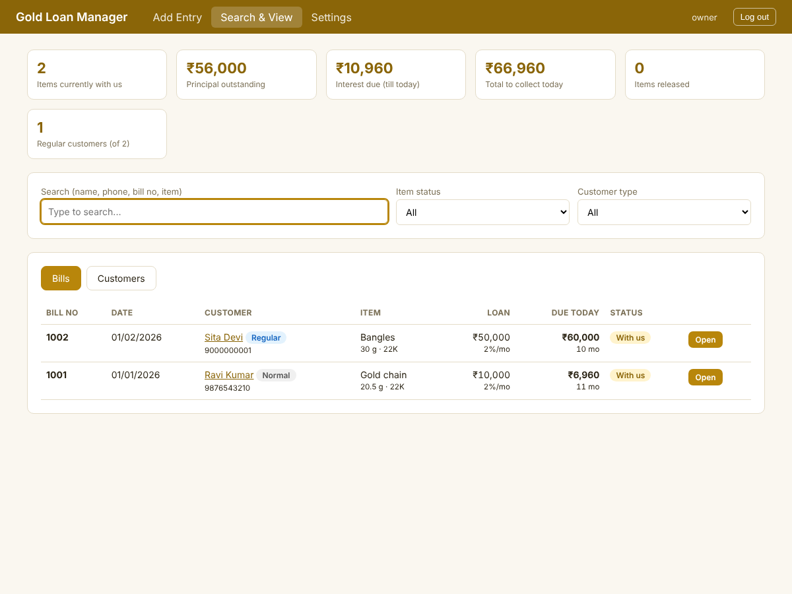
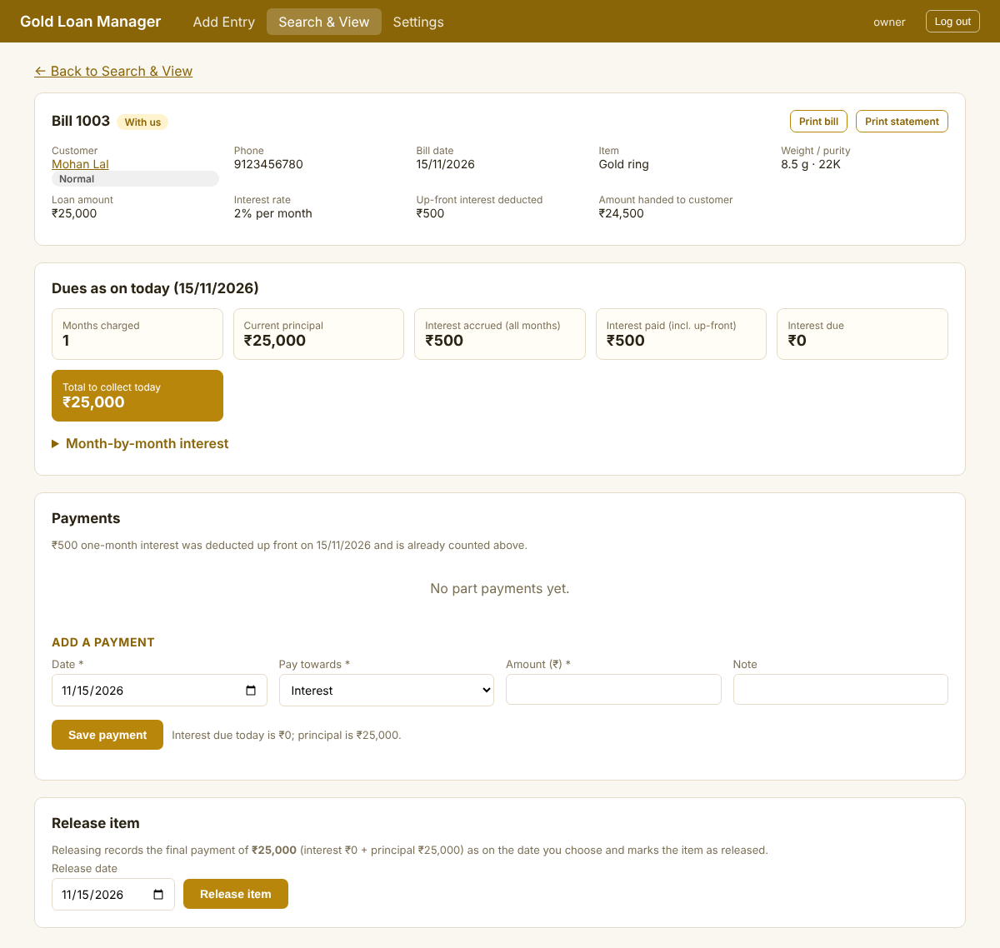
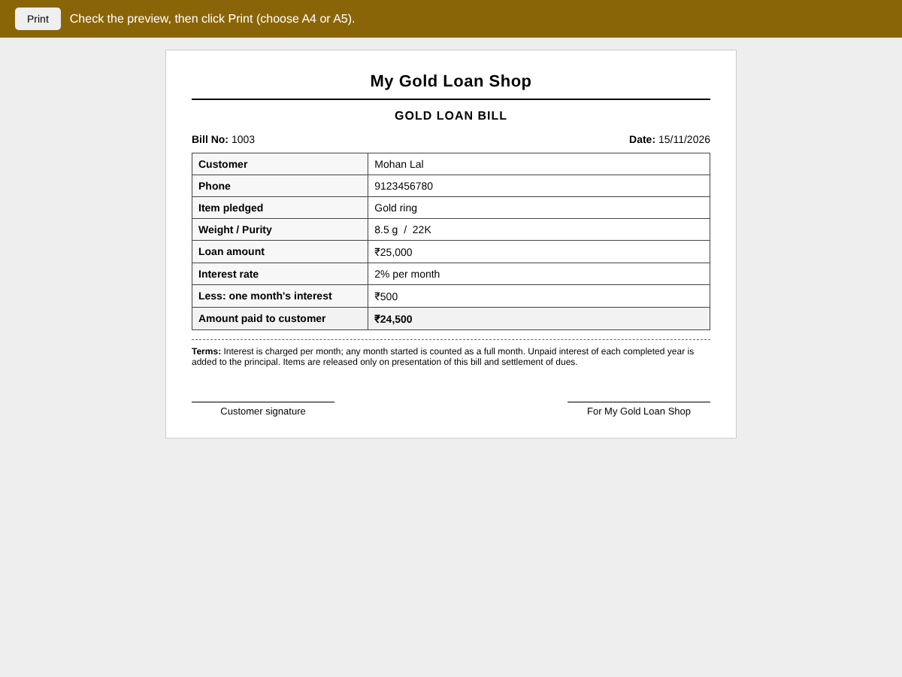

# Gold Loan Manager

A simple, self-hosted pawn broker / gold loan management system that runs on your own computer. It keeps customer records, pledged items, bills, part payments and interest in a local database, and prints bills and receipts.

No cloud account, no subscription. Your data stays in one file on your machine.



## Features

- **Owner login** with securely hashed password, session timeout and login throttling
- **Two kinds of customers**
  - *Normal (walk-in)*: enter customer details and the bill together
  - *Regular*: register once, then add any number of bills later
- **Search and filter** by name, phone, bill number or item; filter by "with us" / "released" and by customer type
- **Interest calculation**
  - Simple monthly interest (a started month counts as a full month)
  - After each completed year, the unpaid interest is added to the principal (yearly compounding)
  - Optional one-month interest deducted up front when the loan is given
- **Part payments** recorded towards interest or principal, with a receipt for each
- **Release and reopen** items, with the final settlement recorded
- **Printable documents**: loan bill, payment receipt and full statement (month-by-month interest), for A4 or A5
- **Backups**: automatic daily copy (last 14 kept) and a one-click download
- **Zero database setup**: uses SQLite through Node's built-in module

| Bill detail and payments | Printable bill |
|---|---|
|  |  |

*Screenshots use made-up sample data.*

## Requirements

- [Node.js](https://nodejs.org) **22.13 or newer** (LTS recommended)

## Quick start

```bash
git clone https://github.com/tushaarsingavi/Pawn-Broker-Management.git
cd gold-loan-manager
npm install
npm start
```

Then open **http://localhost:3000**.

On **Windows** you can instead double-click `start.bat`. On **Mac**, double-click `start.command`.

On first run you are asked to create the owner account. Then open **Settings** and enter your shop name, address, phone and licence number, which are printed on bills.

### Configuration (optional)

| Variable | Default | Meaning |
|---|---|---|
| `PORT` | `3000` | Port to listen on |
| `HOST` | `127.0.0.1` | Address to listen on. Keep the default so only this computer can connect |
| `DATA_DIR` | `./data` | Where the database and backups are stored |

## How interest is calculated

1. Each month, interest = current principal x monthly rate. A month that has started counts as a full month, with a minimum of one month.
2. After every completed 12 months, any **unpaid** interest of that year is added to the principal. The following year's interest is charged on the new principal.
3. If "deduct one month's interest up front" is on, the customer receives the loan amount minus one month's interest. That amount counts as interest paid on the loan date.
4. Part payments are entered as **interest** or **principal**. A principal payment reduces the interest base from the next month onward.
5. Releasing a bill records the final settlement (remaining interest and principal) on the chosen date.

The rules live in [`server/interest.js`](server/interest.js) and are covered by tests (`npm test`). If your shop calculates differently, that is the one file to change.

## Data and backups

- Everything is stored in `data/goldloan.db` (SQLite).
- A daily copy is saved to `data/backups/` (the last 14 are kept).
- **Settings > Download backup now** downloads a consistent copy.
- To restore, stop the app, replace `data/goldloan.db` with the backup, and start it again.
- **Never commit or share the `data` folder.** It contains customer personal information. The included `.gitignore` excludes it.

### Forgot your password

```bash
npm run reset-password -- yourusername NewPassword123
```

## Project structure

```
server/        Express API, SQLite access, interest engine
public/        Pages: login, add entry, search, bill detail, settings, print
scripts/       Password reset helper
test/          Interest calculation tests
docs/          Screenshots
```

## Security notes

- Designed for **one computer, one owner**, on `localhost`. There is no HTTPS and no multi-user roles.
- **Do not expose it to the internet** (port forwarding, public hosting) without putting it behind HTTPS and proper access control.
- Passwords are hashed with bcrypt. Sessions use HttpOnly, SameSite cookies.
- Protect the computer itself (login password, disk encryption), since the database file is not encrypted.

## Limitations

- Single user, no staff roles
- No item photos, SMS or reminder notifications yet
- Interest rules are fixed to the model above (no slab or tiered rates)

## Disclaimer

This software is provided as-is, without warranty. It is **not** legal, tax or financial advice. Pawn broking is regulated in many places, so check your local licensing and record-keeping rules. **Verify the interest calculations against your own records before relying on them for real transactions.** You are responsible for your data and backups.

## Contributing

Issues and pull requests are welcome. Run `npm test` before submitting changes. Please never include real customer data in issues, screenshots or pull requests.

## License

[MIT](LICENSE)
